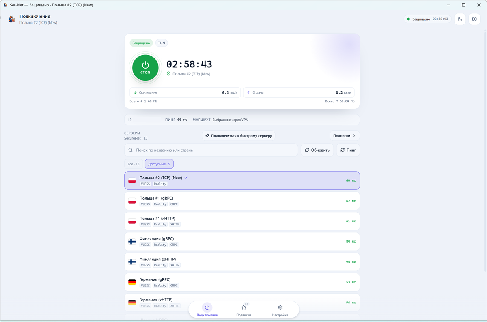
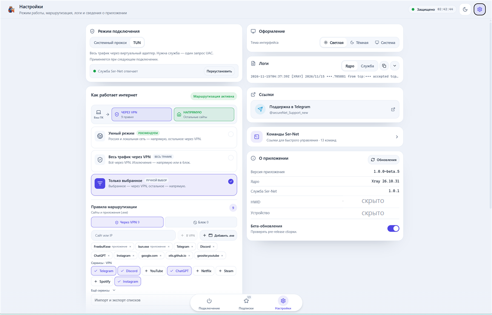

  <strong>Русский</strong> | <a href="README_EN.md">English</a>

<h1>Ser-Net</h1>

<b>VPN-клиент для Windows x64 на Xray-core: подписки, умная маршрутизация и управление ссылками <code>sernet://</code>.</b>

  
  
  
  
  

  <a href="https://github.com/bgkv44/Ser-Net/releases">Скачать</a> ·
  <a href="https://github.com/bgkv44/Ser-Net-android">Android</a> ·
  <a href="https://bgkv44.github.io/Ser-Net/">Руководство</a> ·
  <a href="https://t.me/secureNet_Support_new">Поддержка</a> ·
  <a href="README_EN.md">English</a>

**Содержание:** [О приложении](#о-приложении) · [Android](#версия-для-android) · [Скриншоты](#скриншоты) · [Возможности](#возможности) · [Протоколы](#поддерживаемые-протоколы) · [Режимы](#режимы-подключения) · [Маршрутизация](#маршрутизация) · [Установка](#установка) · [Первое подключение](#первое-подключение) · [Команды](#команды-sernet) · [Настройки](#настройки) · [Если что-то не работает](#если-что-то-не-работает) · [Поддержка](#поддержка)

## О приложении

Ser-Net — настольный VPN-клиент для Windows, который работает поверх [Xray-core](https://github.com/XTLS/Xray-core). Он берёт серверы из обычной ссылки подписки вашего провайдера и позволяет выбрать один из трёх режимов: пускать Россию напрямую, направлять весь трафик через VPN или завернуть только выбранные сайты и приложения.

> [!NOTE]
> Ser-Net не предоставляет VPN-серверы, подписки и доступ к инфраструктуре. Для работы нужна собственная совместимая ссылка или подписка от вашего провайдера.

## Версия для Android

Ser-Net выходит и для Android: туннель через системный `VpnService`, выбор приложений, плитка в шторке быстрых настроек и те же подписки, что и на компьютере.

- Репозиторий и описание: [bgkv44/Ser-Net-android](https://github.com/bgkv44/Ser-Net-android)
- Скачать APK: [страница релизов](https://github.com/bgkv44/Ser-Net-android/releases/latest) — текущая версия `1.0.0-beta.1.5`, сборки под `arm64-v8a`, `armeabi-v7a`, `x86` и `x86_64`.

Android-версия собирается отдельно от Windows и идёт по своей линейке версий: у неё своё приложение, своя служба и свой versionCode.

## Скриншоты

  

<em>Экран «Подключение»</em> — статус, скорость, IP и список серверов с задержкой. Публичный IP на снимке скрыт.

  

<em>Настройки</em> — выбран «Умный режим»; видны ожидающие изменения. Кнопка «Применить» не нажата. HWID и имя устройства скрыты.

## Возможности

| Возможность | Описание |
|---|---|
| **Подписки** | Несколько ссылок одновременно, серверы активной подписки на главном экране, обновление одной карточки без переключения остальных. |
| **Данные подписки** | Использованный трафик, срок действия, HWID-статус и кнопка личного кабинета — если провайдер передаёт эти данные. |
| **Выбор сервера** | Поиск по названию или стране, TCP-проверка задержки, фильтр доступных узлов и автоматический подбор быстрого сервера с подтверждением. |
| **Маршрутизация** | Три режима, готовые наборы правил для сервисов, свои домены и IP, импорт и экспорт списков. |
| **Режимы туннеля** | Системный прокси без прав администратора или TUN со службой Ser-Net для трафика всей системы. |
| **Обход DPI** | Фрагментация TLS для профилей TLS/REALITY, когда соединение режут по SNI. |
| **Автоматизация** | Автозапуск при входе в Windows, подключение к быстрому серверу при старте и команды `sernet://` для ярлыков. |
| **Диагностика** | Логи ядра и службы, версия ядра, состояние службы и проверка обновлений в приложении. |

## Поддерживаемые протоколы

| Протокол | Поддержка |
|---|---|
| VLESS | ✅ |
| VMess | ✅ |
| Trojan | ✅ |
| Shadowsocks | ✅ |

Hysteria2 не поддерживается: ядро Xray-core с ним не работает.

## Поддерживаемые транспорты

TCP · WebSocket (WS) · gRPC · XHTTP · HTTP

Доступность конкретного транспорта зависит от серверной конфигурации и совместимости с Xray-core.

## Режимы подключения

| Режим | Что делает |
|---|---|
| **Системный прокси** | Прописывает локальный прокси в настройки Windows. Работает без прав администратора; через прокси идут приложения, которые учитывают системные настройки. |
| **TUN** | Поднимает виртуальный сетевой интерфейс и направляет трафик всей системы. Требует установленной службы Ser-Net и подтверждения UAC при установке. |

## Маршрутизация

| Режим | Поведение |
|---|---|
| **Умный режим** | Сайты России и локальная сеть идут напрямую, остальное — через VPN. Подходит для повседневной работы. |
| **Весь трафик через VPN** | Весь трафик идёт в туннель, кроме локальных сетей и заданных исключений. В режиме системного прокси называется «Трафик через прокси». |
| **Только выбранное** | Через VPN идут только правила из списка «Через VPN», остальное — напрямую. В этом режиме работает блокировка рекламных доменов. |

При активном подключении изменения сначала помечаются как «Есть изменения» и применяются кнопкой **«Применить»**. Если подписка отдаёт готовый JSON-конфигурации, маршрутизацию задаёт провайдер.

## Требования

- Windows 10 или 11, 64-битная система.
- Совместимая конфигурация Xray-core.
- Собственная ссылка подключения или подписка.
- Для TUN — служба Ser-Net (устанавливается из приложения, требует подтверждения UAC).

## Установка

1. Откройте [страницу релизов](https://github.com/bgkv44/Ser-Net/releases).
2. Выберите файл:
   - **Установщик** `Ser-Net_..._x64-setup.exe` — обычная установка в систему;
   - **Портативная версия** `SerNet-...-windows-x64-portable.zip` — распакуйте в любую папку и запустите без установки.
3. Запустите Ser-Net.

Текущие сборки помечены как **бета** — это тестовые версии, которые могут меняться между релизами.

## Первое подключение

1. Откройте раздел **«Подписки»** в нижней навигации.
2. Нажмите **«Добавить подписку»**, вставьте ссылку и нажмите **«Загрузить»**. Ссылку можно вставить из буфера обмена.
3. Если подписок несколько, нажмите **«Выбрать»** на нужной — её серверы появятся на главном экране.
4. На экране **«Подключение»** выберите сервер и нажмите круглую кнопку питания. Либо нажмите **«Подключиться к быстрому серверу»**: приложение проверит узлы и предложит подтвердить подключение.
5. При необходимости выберите режим подключения и режим маршрутизации в настройках.

## Команды `sernet://`

Команды управляют приложением из ярлыка, скрипта или другого приложения. Шаблоны в фигурных скобках нужно заменить своими данными.

| Команда | Действие |
|---|---|
| `sernet://connect` | Подключиться к выбранному серверу; если сервер не выбран — запустить подбор быстрого сервера. |
| `sernet://open` | Показать окно и подключиться, если VPN ещё не подключён. |
| `sernet://disconnect` | Отключить VPN. |
| `sernet://toggle` | Включить VPN, если он выключен, и наоборот. |
| `sernet://best` | Проверить серверы и выбрать самый быстрый. |
| `sernet://refresh` | Обновить серверы активной подписки. |
| `sernet://add/{ссылка}` | Добавить подписку по ссылке в URL-кодировании. |
| `sernet://server/{имя-или-код-страны}` | Выбрать сервер по коду страны или части названия. |
| `sernet://routing/off` | Вернуть «Умный режим»; ручные правила сохраняются. |
| `sernet://routing/mode/smart` | Включить «Умный режим». |
| `sernet://routing/mode/global` | Включить режим «Весь трафик через VPN». |
| `sernet://routing/mode/selective` | Включить режим «Только выбранное». |
| `sernet://routing/add/{base64}` | Импортировать правила из base64url: JSON с массивами `proxy`/`direct`/`block` или список строк. |

Полный справочник с копированием доступен в приложении: **Настройки → «Команды Ser-Net»**.

## Настройки

- **Режим подключения** — системный прокси или TUN; выбранный вариант применяется при следующем подключении.
- **Служба Ser-Net** — состояние, установка, обновление и переустановка.
- **Автозапуск** — запуск при входе в Windows без запроса UAC.
- **Защита трафика при запуске** — при следующем старте приложение проверяет серверы и подключается к самому быстрому.
- **Оформление** — светлая, тёмная или системная тема.
- **Логи** — журналы ядра и службы для диагностики.
- **Обновления** — встроенная проверка новых версий и ручная проверка в разделе «О приложении».

> [!WARNING]
> Ссылка подписки — это доступ к вашему аккаунту. Не публикуйте её в чатах и не прикладывайте к issues. Для диагностики достаточно логов без ссылки.

## Если что-то не работает

- **Серверы не появились** — проверьте ссылку подписки и нажмите «Обновить». При ошибке загрузки старый список сохраняется.
- **Не подключается** — попробуйте другой сервер и проверьте режим подключения. Для TUN убедитесь, что служба Ser-Net установлена.
- **Сайт идёт не тем маршрутом** — проверьте режим, нужный список правил и примените ожидающие изменения.
- **Нужны детали** — откройте «Настройки» → «Логи», скопируйте журнал и приложите его к обращению.

## Поддержка

- Руководство пользователя: [bgkv44.github.io/Ser-Net](https://bgkv44.github.io/Ser-Net/)
- Telegram: [@secureNet_Support_new](https://t.me/secureNet_Support_new)
- Ошибки и предложения: [GitHub Issues](https://github.com/bgkv44/Ser-Net/issues)

При обращении укажите версию из раздела «О приложении» и приложите логи. Ссылку подписки и пароли не отправляйте.

## Исходный код

В этом репозитории публикуются готовые сборки, документация и руководство пользователя. Исходный код приложения здесь не размещён, поэтому собрать программу из этого репозитория нельзя — используйте файлы со [страницы релизов](https://github.com/bgkv44/Ser-Net/releases).

## Важно

Перед использованием и распространением программы проверяйте требования законодательства в своей юрисдикции. Не используйте и не распространяйте её там, где это запрещено или ограничено применимым законодательством.

---

  Ser-Net · <a href="#">Наверх</a> · <a href="README_EN.md">English version</a> · <a href="https://github.com/bgkv44/Ser-Net/releases">Релизы</a>

