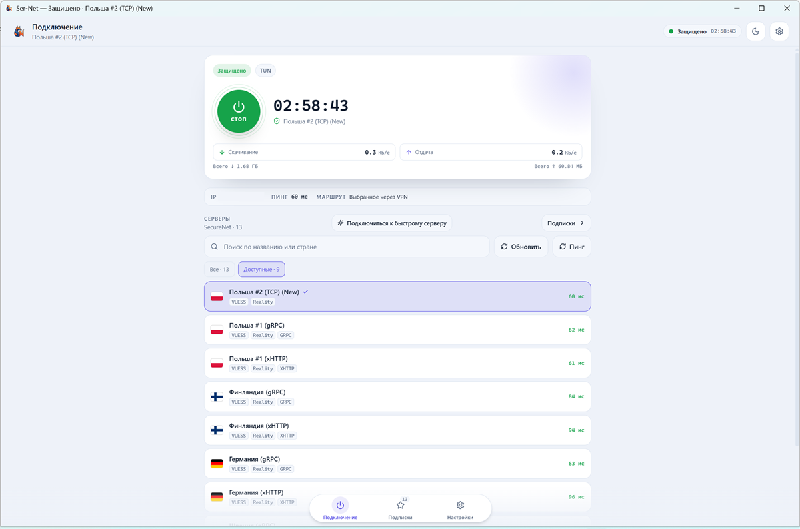
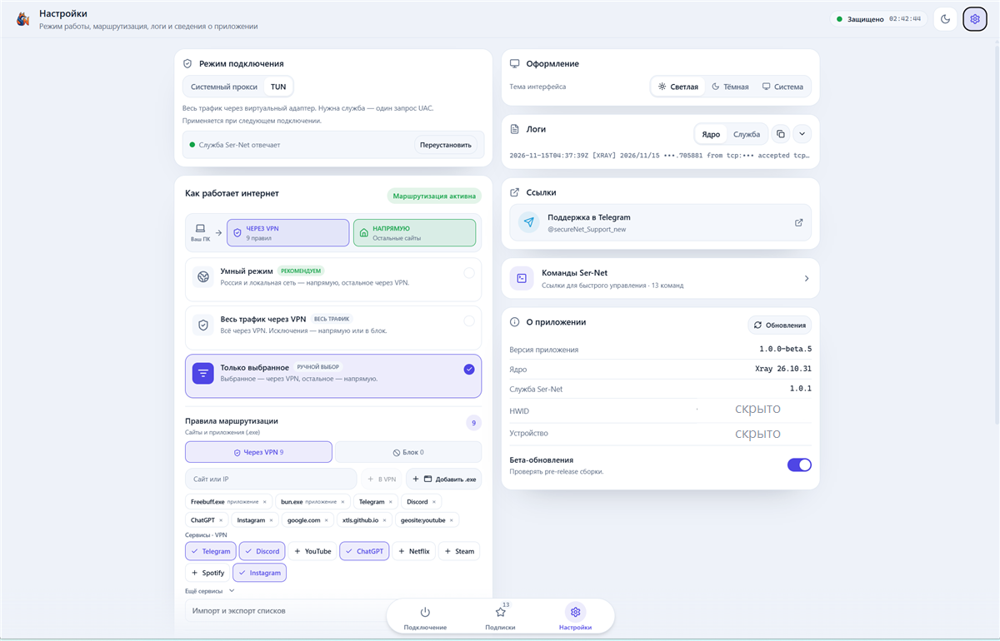

  <a href="README.md">Русский</a> | <strong>English</strong>

<h1>Ser-Net</h1>

<b>A VPN client built on Xray-core for Windows and Android: subscriptions, smart routing and <code>sernet://</code> links.</b>

  
  
  
  
  

  <a href="https://github.com/bgkv44/Ser-Net/releases">Download</a> ·
  <a href="https://bgkv44.github.io/Ser-Net/">User guide</a> ·
  <a href="https://t.me/secureNet_Support_new">Support</a> ·
  <a href="README.md">Русский</a>

**Contents:** [About](#about) · [Versions](#versions-and-platforms) · [Screenshots](#screenshots) · [Features](#features) · [Protocols](#supported-protocols) · [Modes](#connection-modes) · [Routing](#routing) · [Android](#android) · [Install](#installation) · [First connection](#first-connection) · [Commands](#sernet-commands) · [Settings](#settings) · [Troubleshooting](#troubleshooting) · [Support](#support)

## About

Ser-Net is a VPN client built on [Xray-core](https://github.com/XTLS/Xray-core) for Windows and Android. It reads servers from a standard provider subscription link and lets you choose one of three modes: keep Russian sites direct, route all traffic through the VPN, or tunnel only the sites and applications you pick.

Both platforms share the same core and the same set of supported protocols. They are released separately, with their own version numbers and files.

> [!NOTE]
> Ser-Net does not provide VPN servers, subscriptions or infrastructure access. You need your own compatible link or subscription from a provider.

## Versions and platforms

| Platform | Version | Release files |
|---|---|---|
| **Windows 10 and 11 x64** | `1.0.0-beta.6` | `.exe` installer and portable `.zip` |
| **Android 7.0 and newer** | `1.0.0-beta.1.1` (versionCode `1000004`) | `.apk` for ARM and x86 |

Platform versions are independent: updating Android does not change the Windows version, and vice versa. Current builds are marked **beta**: test versions that may change between releases.

## Screenshots

  

<em>Connection screen</em> — status, speed, IP and servers with latency. The public IP is hidden in the screenshot.

  

<em>Settings</em> — Smart mode is selected and pending changes are visible. Apply was not pressed. HWID and device name are hidden.

## Features

| Feature | Details |
|---|---|
| **Subscriptions** | Several links at once, the active subscription's servers on the main screen, and per-card refresh without switching the others. |
| **Subscription data** | Traffic used, expiry date, HWID status and a provider dashboard button when the subscription exposes them. |
| **Server selection** | Search by name or country, TCP latency checks, an available-only filter, and fastest-server picking with confirmation. |
| **Routing** | Three modes, ready-made service presets, custom domains and IPs, list import and export. |
| **DPI evasion** | TLS fragmentation for TLS/REALITY profiles when connections are blocked by SNI. |
| **Diagnostics** | Core and service logs, core version, service state and update checks inside the app. |
| **Windows: tunnel modes** | System proxy without administrator rights, or TUN through the Ser-Net service for system-wide traffic. |
| **Windows: tray and automation** | Tray menu with country flags, launch at Windows sign-in, auto-connect to the fastest server at startup, and `sernet://` links. |
| **Android: per-app routing** | Send everything through the VPN except selected apps, or only the apps you tick. |
| **Android: quick controls** | Persistent notification with pause, resume and disconnect, plus a Ser-Net quick settings tile. |
| **Android: adding subscriptions** | Link input, clipboard paste and QR-code import. |

## Supported protocols

Protocols are the same on Windows and Android.

| Protocol | Support |
|---|---|
| VLESS | ✅ |
| VMess | ✅ |
| Trojan | ✅ |
| Shadowsocks | ✅ |

Hysteria2 is not supported: Xray-core does not work with it. If a subscription contains such a node, it cannot connect — the rest of the list keeps working.

## Supported transports

TCP · WebSocket (WS) · gRPC · XHTTP · HTTP

The availability of a specific transport depends on the server configuration and its compatibility with Xray-core.

## Connection modes

**Windows**

| Mode | Behaviour |
|---|---|
| **System proxy** | Sets a local proxy in Windows settings. Works without administrator rights; apps that honour system proxy settings use it. |
| **TUN** | Brings up a virtual network interface and routes traffic for the whole system. Requires the installed Ser-Net service and a UAC confirmation during installation. |

**Android**

| Mode | Behaviour |
|---|---|
| **Android VPN connection** | Runs through the system VPN service (VpnService) and sends device traffic into the tunnel. On the first connection Android asks you to allow creating a VPN connection. There is no system proxy on Android. |

## Routing

**Windows**

| Mode | Behaviour |
|---|---|
| **Smart** | Russian sites and the local network stay direct; everything else goes through the VPN. |
| **All traffic through VPN** | Everything is tunnelled except local networks and your exceptions. In system proxy mode it is labelled “Traffic through proxy”. |
| **Selected only** | Only rules in the “Through VPN” list are tunnelled; everything else stays direct. Ad-domain blocking works in this mode. |

**Android**

| Mode | Behaviour |
|---|---|
| **Smart** | Russian resources and the local network stay direct; the rest goes through the VPN. |
| **All traffic through VPN** | Everything is tunnelled; individual apps can be excluded. |
| **Selected only** | Only the ticked apps use the VPN, everything else stays direct. |

On Windows, changes made during an active connection are marked as pending and applied with the **Apply** button. If a subscription ships a ready-made JSON config, routing is controlled by the provider.

## Android

The Android app is a separate build on the same Xray-core, using a system VPN tunnel instead of the Windows proxy and service.

- **Version:** `1.0.0-beta.1.1`, versionCode `1000004`.
- **Requirements:** Android 7.0 or newer, a provider link or subscription, and permission to create a VPN connection.
- **Included:** subscriptions by link, clipboard and QR code; server latency checks; per-app routing; notification with pause and disconnect; quick settings tile; connection and core logs; ad-domain blocking; light and dark themes.
- **Not included:** system proxy, Ser-Net service, launch at boot and `sernet://` commands — those are Windows-only.

### Which APK to download

Four Android builds are published. Pick the one for your device architecture; if you are unsure, take `arm64-v8a`, which covers most modern phones.

| File | For |
|---|---|
| `Ser-Net_1.0.0-beta.1.1_arm64-v8a.apk` | modern 64-bit phones and tablets |
| `Ser-Net_1.0.0-beta.1.1_armeabi-v7a.apk` | older 32-bit ARM devices |
| `Ser-Net_1.0.0-beta.1.1_x86_64.apk` | 64-bit emulators and x86 devices |
| `Ser-Net_1.0.0-beta.1.1_x86.apk` | 32-bit emulators and x86 devices |

All APKs are signed with the same key, so a new build installs over the previous one without removing the app or losing subscriptions.

## Requirements

**Windows**

- Windows 10 or 11, 64-bit.
- A compatible Xray-core configuration.
- Your own connection link or subscription.
- For TUN: the Ser-Net service (installed from the app, requires a UAC confirmation).

**Android**

- Android 7.0 or newer.
- Your own connection link or subscription.
- Permission to create a VPN connection.

## Installation

**Windows**

1. Open the [releases page](https://github.com/bgkv44/Ser-Net/releases) and pick the Windows release.
2. Pick a file:
   - **Installer** `Ser-Net_..._x64-setup.exe` — regular system installation;
   - **Portable** `SerNet_...-windows-x64-portable.zip` — unpack anywhere and run without installing.
3. Launch Ser-Net.

**Android**

1. Open the releases page and pick the Android release `1.0.0-beta.1.1`.
2. Download the APK for your device architecture (see the table above) and open the file.
3. Allow installation from this source if Android asks, then confirm the installation.
4. Launch Ser-Net and allow creating a VPN connection on the first connect.

## First connection

**Windows**

1. Open **Subscriptions** in the bottom navigation.
2. Click **Add subscription**, paste the link and press **Load**. Pasting straight from the clipboard works too.
3. With several subscriptions, press **Select** on the one you need; its servers appear on the main screen.
4. On the **Connection** screen pick a server and press the round power button. Or press **Connect to fastest server**: the app checks the nodes and asks you to confirm.
5. Adjust the connection and routing modes in settings if needed.

**Android**

1. On the start screen paste a subscription link or scan a QR code, then load the server list.
2. Pick a server and press the connect button; Android shows the VPN connection request.
3. Choose a routing mode in settings. For Selected only, tick the apps allowed to use the tunnel.
4. Control the connection from the notification or the Ser-Net quick settings tile.

## `sernet://` commands

Commands work in the Windows version only: they control the app from a shortcut, script or another application. Replace placeholders in braces with your own values.

| Command | Action |
|---|---|
| `sernet://connect` | Connect to the selected server, or start fastest-server picking when none is selected. |
| `sernet://open` | Show the window and connect if the VPN is not running. |
| `sernet://disconnect` | Disconnect the VPN. |
| `sernet://toggle` | Turn the VPN on if it is off, and vice versa. |
| `sernet://best` | Check servers and pick the fastest one. |
| `sernet://refresh` | Refresh the active subscription. |
| `sernet://add/{url}` | Add a subscription from a URL-encoded link. |
| `sernet://server/{name-or-country-code}` | Select a server by country code or part of its name. |
| `sernet://routing/off` | Return to Smart mode; manual rules are kept. |
| `sernet://routing/mode/smart` | Enable Smart mode. |
| `sernet://routing/mode/global` | Enable All traffic through VPN. |
| `sernet://routing/mode/selective` | Enable Selected only. |
| `sernet://routing/add/{base64}` | Import rules from base64url: JSON arrays `proxy`/`direct`/`block`, or a plain list. |

The in-app reference with copy buttons lives under **Settings → Ser-Net commands**.

## Settings

**Windows**

- **Connection mode** — system proxy or TUN; applied on the next connection.
- **Ser-Net service** — state, install, update and reinstall.
- **Autostart** — launch at Windows sign-in without a UAC prompt.
- **Protect traffic at startup** — on the next launch the app checks servers and connects to the fastest one.
- **Appearance** — light, dark or system theme.
- **Logs** — core and service journals for diagnostics.
- **Updates** — built-in version checks plus a manual check under About.

**Android**

- **Apps through VPN** — app lists for All traffic and Selected only modes.
- **Ad-domain blocking** — available in the app settings.
- **Appearance** — light and dark theme.
- **Logs** — connection and Xray journals for diagnostics.
- **About** — version and build details.

> [!WARNING]
> A subscription URL is access to your account. Do not post it in chats or attach it to issues. Logs without the link are enough for diagnostics.

## Troubleshooting

- **No servers appeared** — check the subscription link and press “Refresh”. A failed download keeps the previous list.
- **Cannot connect on Windows** — try another server and check the connection mode. For TUN, make sure the Ser-Net service is installed.
- **Cannot connect on Android** — make sure creating a VPN connection is allowed and try another server. MIUI and similar firmware may stop VPN in the background: allow the app to run without restrictions.
- **A site takes the wrong route** — check the mode, the relevant rule list, and apply pending changes.
- **An app does not use the VPN on Android** — check the mode and the app list; in Selected only the tunnel works only for ticked apps.
- **The APK will not install** — download the build for your device architecture; on modern phones that is `arm64-v8a`.
- **Need details** — open “Settings” → “Logs”, copy the journal and attach it to your report.

## Support

- User guide: [bgkv44.github.io/Ser-Net](https://bgkv44.github.io/Ser-Net/)
- Telegram: [@secureNet_Support_new](https://t.me/secureNet_Support_new)
- Bugs and ideas: [GitHub Issues](https://github.com/bgkv44/Ser-Net/issues)

Include the platform, the version from About and attach logs. Never send your subscription link or passwords.

## Source code

This repository publishes ready-to-use builds for Windows and Android, texts and the user guide. Application source code is not hosted here, so the program cannot be built from this repository — use the files on the [releases page](https://github.com/bgkv44/Ser-Net/releases).

## Important

Check the legal requirements in your jurisdiction before using or distributing the program. Do not use or distribute it where it is prohibited or restricted by applicable law.

---

  Ser-Net · <a href="#">Back to top</a> · <a href="README.md">Русская версия</a> · <a href="https://github.com/bgkv44/Ser-Net/releases">Releases</a>

